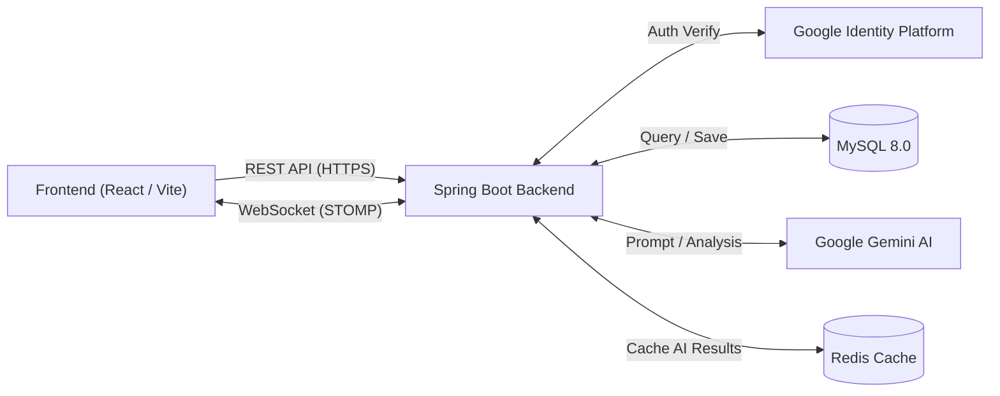

# 🛹 AI FASHION & SKATE PLATFORM
> **AI-powered Fashion & Footwear Shopping Assistant**  
> Nền tảng thương mại điện tử chuyên biệt cho giày, trang phục và ván trượt đường phố, tích hợp Trợ lý Trí tuệ Nhân tạo (Gemini AI) tư vấn phối đồ và đối sánh giá sản phẩm đa sàn.

[](https://spring.io/projects/spring-boot)
[](https://reactjs.org/)
[](https://vitejs.dev/)
[](https://spring.io/guides/gs/messaging-stomp-websocket/)
[](https://developers.google.com/identity)
[](https://www.mysql.com/)
[](https://swagger.io/specification/)

---

## 📌 1. Giới Thiệu Dự Án (Project Overview)
Người mua sắm các sản phẩm giày và thời trang skate thường gặp khó khăn trong việc chọn kích thước (size giày, ván trượt), không biết cách phối trang phục phù hợp với vóc dáng, và mất nhiều thời gian kiểm tra giá giữa các sàn TMĐT (Shopee, Tiki, Lazada).

**AI Fashion Platform** giải quyết triệt để các vấn đề trên thông qua:
1. Trải nghiệm mua sắm mượt mà, hỗ trợ đăng nhập nhanh bằng Google.
2. Tương tác thời gian thực thông qua hệ thống **WebSocket**.
3. **AI Stylist (Gemini Pro)** tư vấn chi tiết thông số sản phẩm và gợi ý trọn bộ trang phục (Outfit).
4. **Market Comparison AI** thu thập và phân tích so sánh giá cả, chất lượng với các sàn lớn.

---

## 📊 2. Tình Trạng Tiến Độ Dự Án (Project Status)

| Phân hệ / Tính năng | Trạng thái | Mô tả chi tiết |
| :--- | :---: | :--- |
| **Xác thực người dùng (Authentication)** | <kbd>ĐÃ XONG</kbd> | Đăng ký, đăng nhập tài khoản email/mật khẩu và đăng nhập một chạm qua **Google OAuth2**; cấp phát Access Token / Refresh Token (JWT). |
| **Quản lý sản phẩm & Biến thể Size** | <kbd>ĐÃ XONG</kbd> | Xem danh mục, danh sách sản phẩm có phân trang, lọc theo thương hiệu, chọn size giày (39, 40, 41...) và kiểm soát tồn kho. |
| **Giỏ hàng & Mua hàng (Cart & Order)** | <kbd>ĐÃ XONG</kbd> | Thêm/sửa/xóa giỏ hàng lưu trên server, quy trình đặt hàng (Checkout), lưu đơn hàng và địa chỉ giao dịch. |
| **Hạ tầng Real-time (WebSocket)** | <kbd>ĐÃ XONG</kbd> | Cấu hình Spring WebSocket STOMP Broker (`/ws/chat`, `/topic/orders`), kết nối hai chiều ổn định. |
| **Giao diện Chatbot & AI Tư vấn sản phẩm** | <kbd>ĐÃ XONG</kbd> | Hoàn thành giao diện Chatbot trực quan; AI (Gemini) đã có thể trò chuyện và tư vấn chi tiết về chất liệu, thông số và cách chọn sản phẩm. |
| **AI Gợi ý phối đồ (Outfit Stylist)** | <kbd>HOÀN THIỆN ẢNH</kbd> | AI đã tạo thành công gợi ý phối set đồ theo phong cách; đang xử lý module hiển thị hình ảnh trực quan khi phối trang phục cùng đôi giày. |
| **AI So sánh sản phẩm giữa các sàn** | <kbd>ĐANG LÀM</kbd> | Thành viên 1 đang thu thập/chuẩn hóa dữ liệu Shopee/Tiki/Lazada; Thành viên 2 đang tích hợp vào hệ thống để AI phân tích và so sánh. |

---

## 🏗️ 3. Kiến Trúc & Công Nghệ (Tech Stack)

* **Frontend:** React, Vite, Tailwind CSS, STOMP WebSocket Client.
* **Backend:** Java 17/21, Spring Boot (Spring Web, Spring Security, Spring Data JPA, Spring WebSocket STOMP).
* **Database & Cache:** MySQL 8.0, Redis (đệm dữ liệu so sánh AI).
* **AI Engine:** Google Gemini Pro API (Structured JSON Prompt).
* **API Specification:** OpenAPI 3.0.3 (Xem chi tiết tại tệp [`openapi.yaml`](./openapi.yaml)).



---

## 👥 4. Phân Công Thành Viên (Team of 2)

| Thành viên | Trách nhiệm chính trong dự án |
| :--- | :--- |
| **Thành viên 1** *(Marketplace Data & Research Lead)* | • **Nghiên cứu & Thu thập dữ liệu sàn:** Chuyên trách tìm kiếm, trích xuất và thu thập dữ liệu sản phẩm tương đương trên các sàn thương mại điện tử lớn (Shopee, Tiki, Lazada).<br>• **Chuẩn hóa dữ liệu:** Tiền xử lý, lọc bỏ dữ liệu rác và chuẩn hóa trường thông tin (tên sản phẩm, giá bán, lượt mua, đánh giá sao, link gốc) để bàn giao cho Thành viên 2 tích hợp vào CSDL.<br>• **Kiểm thử dữ liệu:** Kiểm tra chéo độ chính xác của dữ liệu sàn so với thực tế và hỗ trợ kiểm thử API so sánh. |
| **Thành viên 2** *(Fullstack, AI Integration & Core System Lead)* | • **Đã hoàn thành:**<br>  - Hệ thống xác thực: Đăng nhập Google OAuth2, đăng ký/đăng nhập Email & bảo mật JWT Stateless.<br>  - Toàn bộ luồng mua hàng: Catalog sản phẩm, biến thể size giày, Giỏ hàng (Cart) và Đặt hàng (Checkout).<br>  - Hệ thống Real-time: Cấu hình Spring WebSocket STOMP kết nối Frontend.<br>  - Chatbot tư vấn: Xây dựng giao diện Chatbot và tích hợp AI tư vấn chi tiết về sản phẩm.<br>  - AI Stylist: Đã phát triển xong logic AI gợi ý phối đồ theo phong cách.<br>• **Đang triển khai & phụ trách tiếp:**<br>  - Tích hợp dữ liệu sàn từ Thành viên 1 vào hệ thống; xây dựng prompt cho Gemini AI phân tích, đối sánh giá và ưu/nhược điểm.<br>  - Xây dựng giải pháp hiển thị hình ảnh trực quan (visual mapping) minh họa cho set đồ phối cùng với đôi giày.<br>  - Quản lý đặc tả API Contract `openapi.yaml`, Swagger UI và tích hợp toàn diện Frontend – Backend. |

---


## 🚀 5. Hướng Dẫn Cài Đặt & Chạy Dự Án (Getting Started)

### 1. Khởi chạy Backend (Spring Boot)
```bash
cd demo
# Chạy trên Windows
./mvnw.cmd spring-boot:run
```
* Backend API: `http://localhost:8080`
* Swagger UI: `http://localhost:8080/swagger-ui.html`
* WebSocket Endpoint: `ws://localhost:8080/ws/chat`

### 2. Khởi chạy Frontend (React + Vite)
```bash
cd Frontend
npm install
npm run dev
```
* Giao diện người dùng: `http://localhost:5173`

---

## 📑 7. Tài Liệu Thiết Kế Kèm Theo (Design Deliverables)
* **API Specification:** [`openapi.yaml`](./openapi.yaml)
* **Slide & Báo cáo Thiết kế (Tuần 12):** [`AI_Fashion_Platform_Design_Review_Week_12.docx`](./AI_Fashion_Platform_Design_Review_Week_12.docx)
